# Strategy Desk — инструкция для начинающих

Как поставить программу, что нажимать утром, днём и вечером, и что делать, если что-то не работает. Написано для человека, который никогда не ставил «программы для разработчиков». Если слово непонятно, в конце есть словарь. На картинках демо-данные (придуманные дни 14–18 сентября), поэтому цифры там условные, а подписи с пометкой «[демо]».

Содержание

1. [Что это и чего от него ждать](#1-что-это-и-чего-от-него-ждать)
2. [Что нужно до установки](#2-что-нужно-до-установки)
3. [Установка](#3-установка)
4. [Первый запуск: мастер настройки](#4-первый-запуск-мастер-настройки)
5. [Главный экран](#5-главный-экран)
6. [Утро: обзор перед Европой](#6-утро-обзор-перед-европой)
7. [День: обзор перед Америкой](#7-день-обзор-перед-америкой)
8. [Вечер: итог дня](#8-вечер-итог-дня)
9. [Пятница: неделя и идеи](#9-пятница-неделя-и-идеи)
10. [Вкладка «Чат»](#10-вкладка-чат)
11. [Настройки](#11-настройки)
12. [Если что-то не работает](#12-если-что-то-не-работает)
13. [Где лежат данные и как удалить](#13-где-лежат-данные-и-как-удалить)
14. [Словарь](#14-словарь)

Для разработчиков: устройство, сборка и запуск из исходников — [docs/DEVELOPMENT.md](docs/DEVELOPMENT.md).

---

## 1. Что это и чего от него ждать

Strategy Desk — программа для Windows. Три раза в торговый день она готовит обзор рынка:

| Когда (по Киеву) | Что | Для чего |
|---|---|---|
| 09:30 | Обзор перед открытием Европы | DAX (FDAX), Euro Stoxx (FESX), открытие в 10:00 |
| 16:00 | Обзор перед открытием Америки | S&P 500 (ES), Nasdaq (NQ), открытие в 16:30 |
| 20:00 | Итог дня | Что было на самом деле, кто был прав, урок дня |

Обзор делает агент (Claude). Он читает новости, смотрит график и говорит простыми словами: куда вероятнее пойдёт цена в первые два часа после открытия, можно ли сегодня торговать по вашим правилам и что делать. Вечером он сравнивает утро с фактом и записывает урок.

Чего программа **не делает**: не открывает и не закрывает сделки, не даёт команду «входи», не торгует вместо вас. Решение всегда ваше.

Главная идея: сначала ваш взгляд, потом стрелка. Каждое утро вы одним нажатием говорите, куда, по-вашему, пойдёт рынок, и только потом видите мнение программы. Вечером видно, кто был прав: вы, шкала или никто. Так программа помогает вам думать, а не думает за вас.

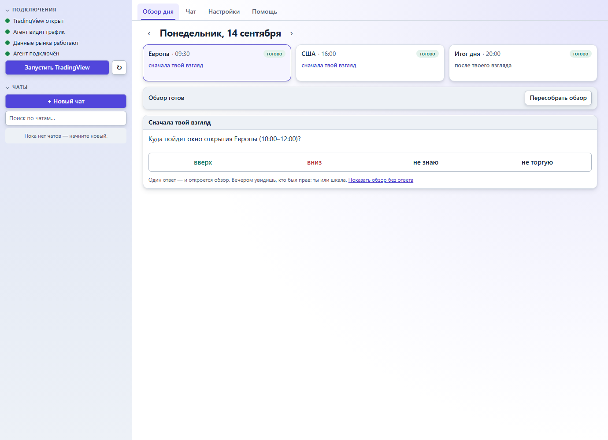

## 2. Что нужно до установки

1. **Компьютер с Windows 10 или 11**, 64-битная версия (почти любой компьютер последних лет). Около 1,5 ГБ свободного места: сама программа 200 МБ, плюс 600 МБ она доустановит себе при первом запуске.
2. **Подписка Claude** (Pro или Max) на сайте claude.ai. Это аккаунт, под которым работает агент. Программа использует вашу подписку, своих платежей у неё нет. Если подписки нет, оформите её до установки.
3. **Аккаунт TradingView** (tradingview.com). Через него программа берёт бары и календарь новостей. Подойдёт и бесплатный аккаунт. Вам понадобится скопировать из браузера одну строку (cookie `sessionid`), как это сделать, расписано в шаге 4.5.
4. **TradingView Desktop**, программа TradingView для Windows. Она нужна, чтобы агент рисовал уровни на графике и делал снимки. Если её нет, установщик предложит поставить её сам.
5. **Интернет** при установке и при первом запуске. Дальше интернет нужен только для новостей и баров.
6. **Компьютер должен быть включён** в 09:30, 16:00 и 20:00 по Киеву и в Windows выполнен вход. Обзоры запускает планировщик Windows, спящий компьютер их не сделает.

## 3. Установка

### 3.1. Скачать

Откройте страницу релизов: <https://github.com/Miha21222/strategy-desk/releases>. В самом верху последняя версия. В списке файлов нажмите `Strategy-Desk-<версия>-x64.exe` (около 190 МБ). Файл `.sha256` рядом не нужен, это контрольная сумма для проверки.

### 3.2. Запустить установщик

Откройте скачанный файл двойным нажатием.

**Windows покажет синее окно «Система Windows защитила ваш компьютер».** Это не ошибка. Так Windows предупреждает о любой программе, у которой нет платной подписи издателя. Нажмите **«Подробнее»**, потом **«Выполнить в любом случае»**.

Дальше установщик проводит по страницам:

1. **Папка установки.** Оставьте как есть. Программа ставится только для вашего пользователя и не просит прав администратора.
2. **TradingView Desktop.** Установщик проверяет, есть ли TradingView Desktop на компьютере.
   - Есть: страница так и скажет, ничего делать не нужно.
   - Нет: будет галочка «Установить TradingView Desktop через winget». Оставьте её, установщик скачает TradingView сам (около 100 МБ). Если winget на компьютере нет, галочка откроет страницу загрузки TradingView после установки, тогда поставьте его оттуда.
   На этой же странице написано: Claude Code ставить отдельно не нужно, он внутри программы. Нужна только подписка.
3. **Установка.** Полоса прогресса, около минуты.
4. **Готово.** Галочка «Запустить Strategy Desk». На рабочем столе и в меню «Пуск» появится ярлык.

Что попало на компьютер: сама программа, агент Claude Code, Python и сервер рыночных данных (tvmcp), шаблон папки данных. Всё в вашей папке пользователя, система не трогается.

## 4. Первый запуск: мастер настройки

При первом запуске открывается мастер из шести шагов. Правило мастера: что программа может сделать сама, она делает сама, как только вы открываете шаг. Где нужно ваше решение или ваш вход, она ждёт кнопки.

На каждом шаге внизу есть «Дальше», «Назад» и «Пропустить шаг». Пропущенный шаг можно пройти потом: мастер всегда есть во вкладке «Помощь» и в «Настройках».

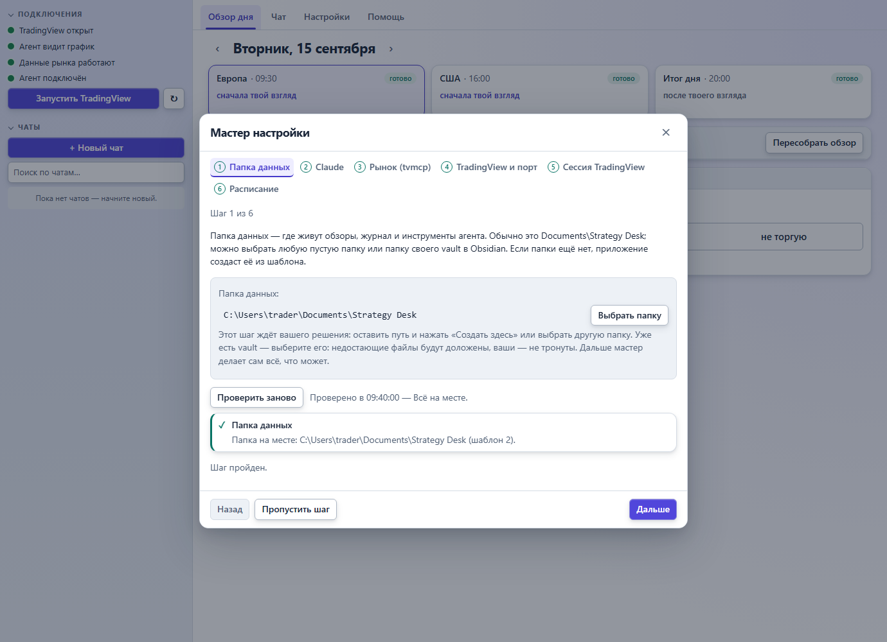

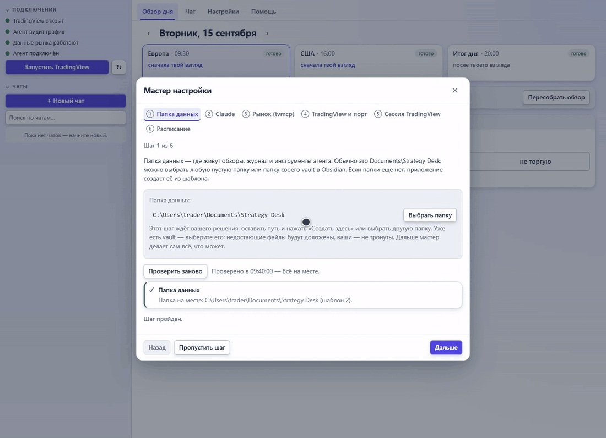

### 4.1. Папка данных

Это папка, где будут лежать обзоры, журнал уроков и инструменты агента. По умолчанию `Документы\Strategy Desk`.

- Если вы ставите программу впервые: оставьте путь и нажмите **«Создать здесь»**. Программа скопирует туда шаблон (скилл обзора, настройки шкалы, пустые папки). Ничего не скачивается.
- Если у вас уже есть папка проекта (например, vault в Obsidian): нажмите **«Выбрать папку»** и укажите её. Программа доложит только недостающие файлы, ваши файлы не тронет.

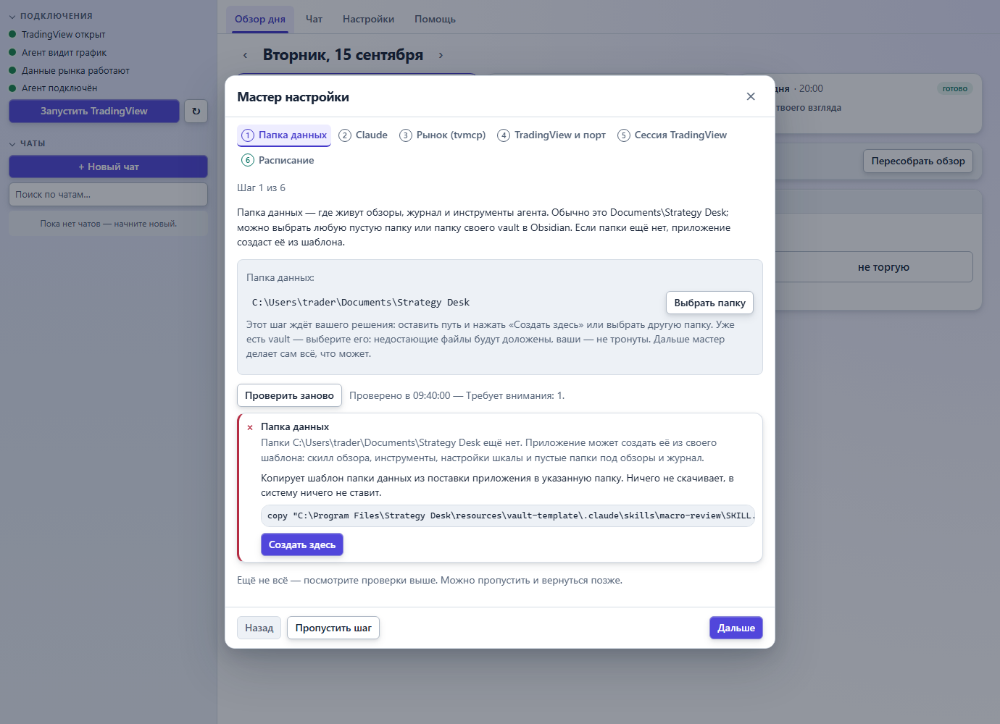

Когда строка проверки стала зелёной, нажмите «Дальше».

### 4.2. Claude

Здесь вы входите в свою подписку Claude. Claude Code ставить не нужно, он внутри программы.

1. Нажмите **«Войти в Claude»**. Откроется браузер со страницей входа Anthropic.
2. Войдите в свой аккаунт (тот, где подписка). Страница покажет **код**, длинную строку.
3. Скопируйте код, вернитесь в программу. В мастере появилось поле «код из браузера». Вставьте код и нажмите **«Отправить код»**.
4. Строка проверки станет зелёной: «Вход по подписке».

Один вход работает и в программе, и в обзорах по расписанию.

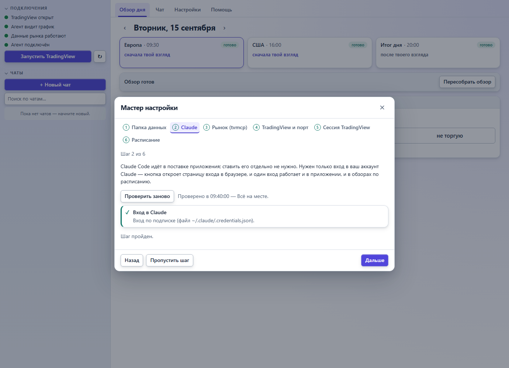

### 4.3. Рынок (tvmcp)

Это сервер рыночных данных. Он идёт вместе с программой, но при первом запуске ему нужно развернуть своё окружение Python. Шаг делает это **сам**, как только открывается: вы увидите команду и бегущий лог. Это несколько минут и около 600 МБ в папке программы, нужен интернет. Ничего в систему не ставится.

Если на этом же шаге предлагается «Скачать браузер», можно нажать, а можно пропустить: без него не работают только картинки отчётов, обзорам дня он не нужен.

Дождитесь зелёных строк и нажмите «Дальше».

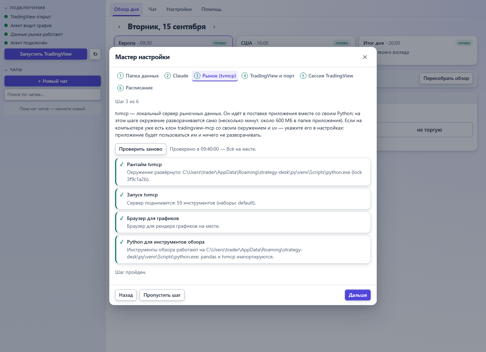

### 4.4. TradingView и порт

Чтобы агент видел график, TradingView Desktop должна быть запущена особым образом (с «портом отладки»). Нажмите **«Запустить TradingView»**: программа откроет её как надо.

Если TradingView уже была открыта обычным способом, закройте её полностью (правой кнопкой по значку в трее, «Выход») и нажмите кнопку ещё раз.

Если строка про порт говорит, что порт занят другой программой, нажмите «Переключить на порт …», программа сама подберёт свободный.

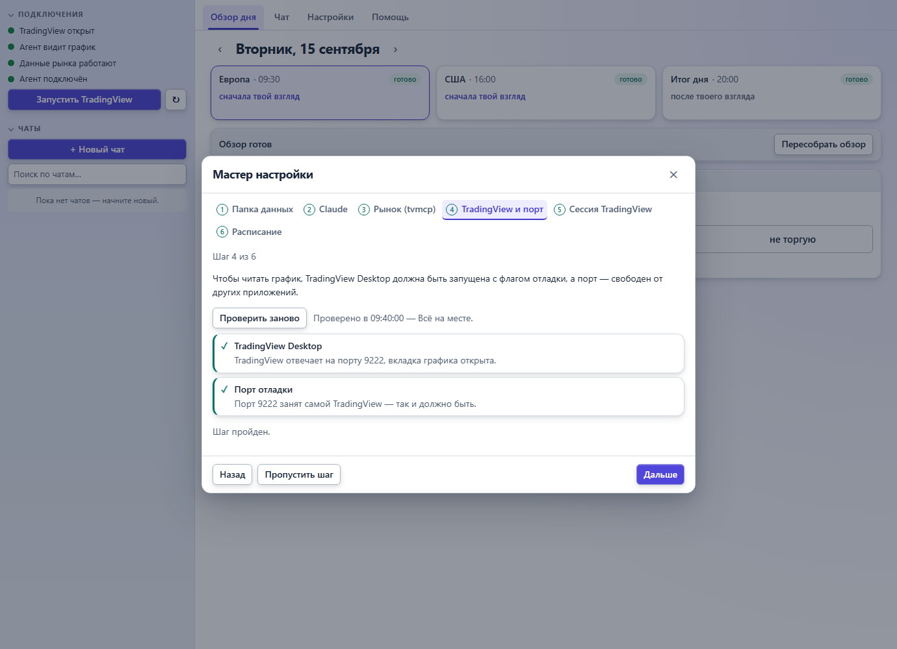

### 4.5. Сессия TradingView (cookie sessionid)

Бары и календарь программа берёт с tradingview.com через ваш аккаунт. Для этого ей нужна одна строка из вашего браузера: cookie с именем `sessionid`. Это как ключ от вашей двери: по нему сайт понимает, что это вы. Храните его при себе, никому не пересылайте. Программа хранит его зашифрованным и отправляет только на tradingview.com.

Как скопировать (на примере Chrome, в Edge то же самое):

1. Откройте в браузере <https://www.tradingview.com> и войдите в свой аккаунт.
2. Нажмите клавишу **F12**. Справа или снизу откроется панель разработчика.
3. В её верхней строке найдите вкладку **Application** (если не видно, нажмите `»` и выберите из списка). В Firefox вкладка называется **Storage**.
4. Слева раскройте **Cookies** и нажмите на `https://www.tradingview.com`.
5. В таблице найдите строку с именем **sessionid**. В колонке Value длинная строка из букв и цифр. Дважды нажмите на неё, выделите всю и скопируйте (Ctrl+C).
6. Вернитесь в программу, вставьте строку в поле **sessionid** и нажмите **«Сохранить»**.
7. Нажмите **«Проверить»**. Программа один раз обратится к tradingview.com. Зелёная строка «Cookie работает» значит, всё в порядке.

Если вы потом выйдете из аккаунта в браузере, cookie перестанет работать. Тогда повторите шаг: Настройки → «Cookie sessionid TradingView».

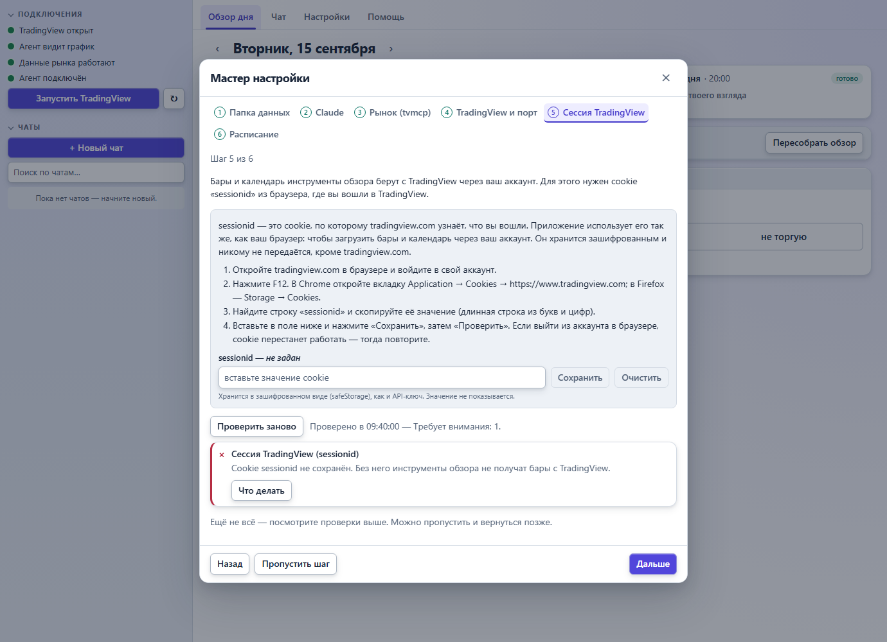

### 4.6. Расписание

Здесь включаются три задачи планировщика Windows: обзор перед Европой в 09:30, перед Америкой в 16:00 (на двух неделях в году, когда Европа и Америка переводят часы в разные дни, в 15:00) и итог дня в 20:00, с понедельника по пятницу.

1. Посмотрите строку про **часовой пояс**. Нужен киевский. Если компьютер на другом времени, задачи сработают не тогда. Поменять: Параметры Windows → Время и язык → Дата и время → часовой пояс «(UTC+02:00) Хельсинки, Киев, Рига…», потом «Проверить заново» в мастере.
2. Нажмите **«Включить расписание»**. Три задачи регистрируются от вашего имени, без прав администратора. Cookie из шага 4.5 при этом записывается в переменные окружения вашего пользователя Windows, иначе задача, запущенная планировщиком, его не увидит.
3. «Убрать расписание» делает обратное: удаляет задачи и переменную.

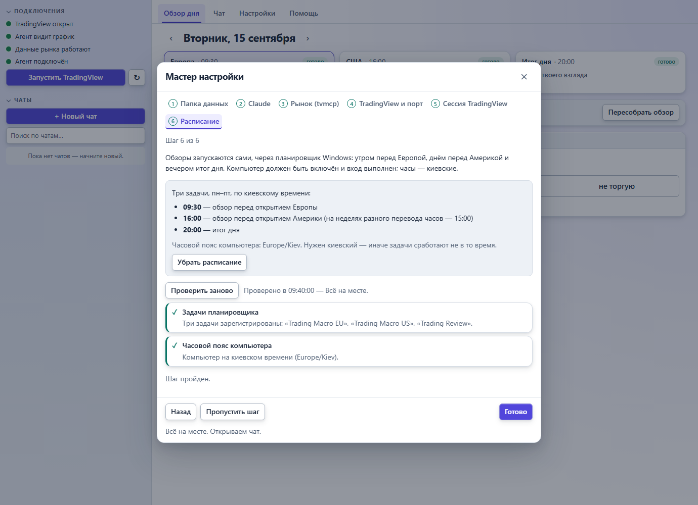

### 4.7. Готово

На последнем шаге вместо «Дальше» стоит кнопка **«Готово»**, а под ней строка «Всё на месте. Открываем чат» или список пропущенных шагов. Нажмите «Готово»: мастер закроется, откроется главный экран.

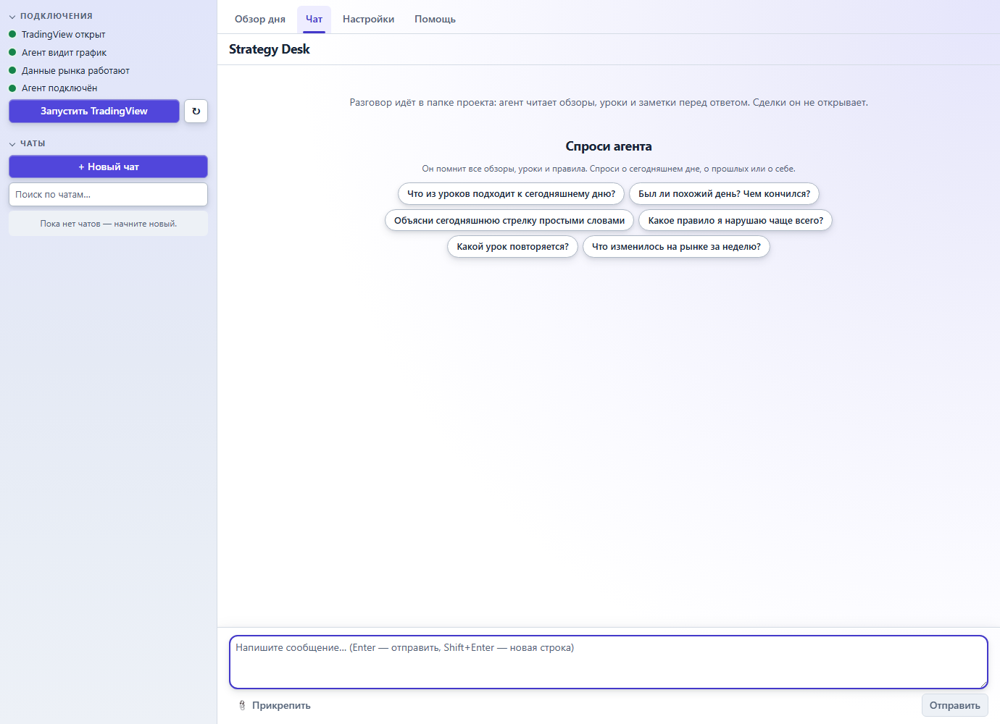

## 5. Главный экран

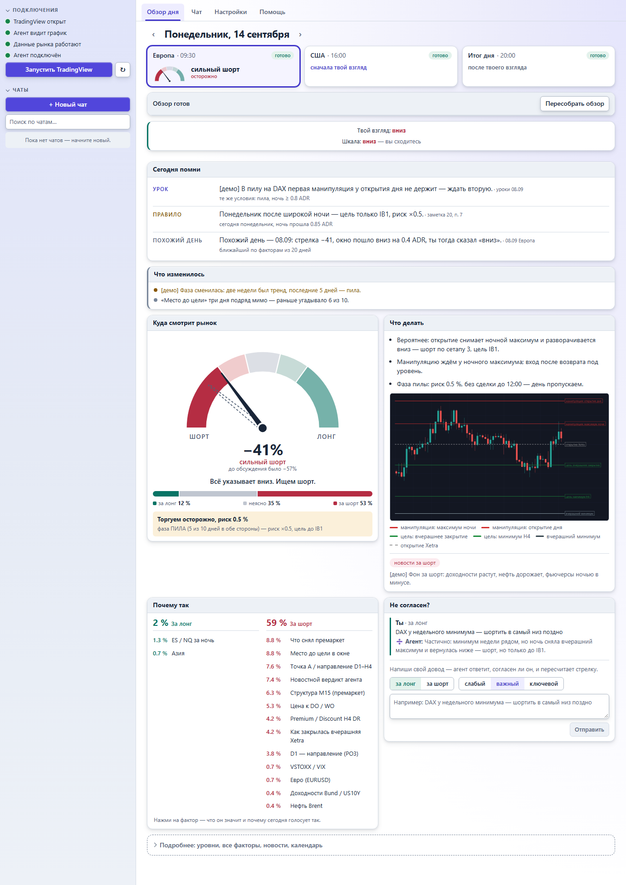

Слева, под заголовком «Подключения», четыре лампочки:

- **TradingView открыт**: программа TradingView Desktop запущена.
- **Агент видит график**: запущена правильно, с портом. Если нет, нажмите «Запустить TradingView».
- **Данные рынка работают**: сервер рыночных данных отвечает.
- **Агент подключён**: вход в Claude есть.

Зелёные все четыре, значит, всё готово. Кнопка со стрелкой рядом обновляет лампочки.

Ниже «Чаты»: кнопка «+ Новый чат» (это вкладка «Чат», см. раздел 10) и список прошлых разговоров.

Сверху четыре вкладки:

| Вкладка | Что там |
|---|---|
| **Обзор дня** | Главный экран: три обзора дня, ваш взгляд, стрелка, план, итог |
| **Чат** | Вопросы агенту, который помнит все обзоры и уроки |
| **Настройки** | Папка данных, cookie, тема; всё остальное спрятано под «Для продвинутых» |
| **Помощь** | Короткая версия этой инструкции и кнопка «Мастер настройки» |

Во вкладке «Обзор дня» под вкладками стоит дата и стрелки `‹ ›`: можно листать прошлые дни и смотреть их обзоры. Под датой три плитки: **Европа · 09:30**, **США · 16:00**, **Итог дня · 20:00**. Справа на плитке её состояние: «ещё не время», «пора», «собирается», «готово», «обзора не было». Нажмите на плитку, и ниже откроется её обзор.

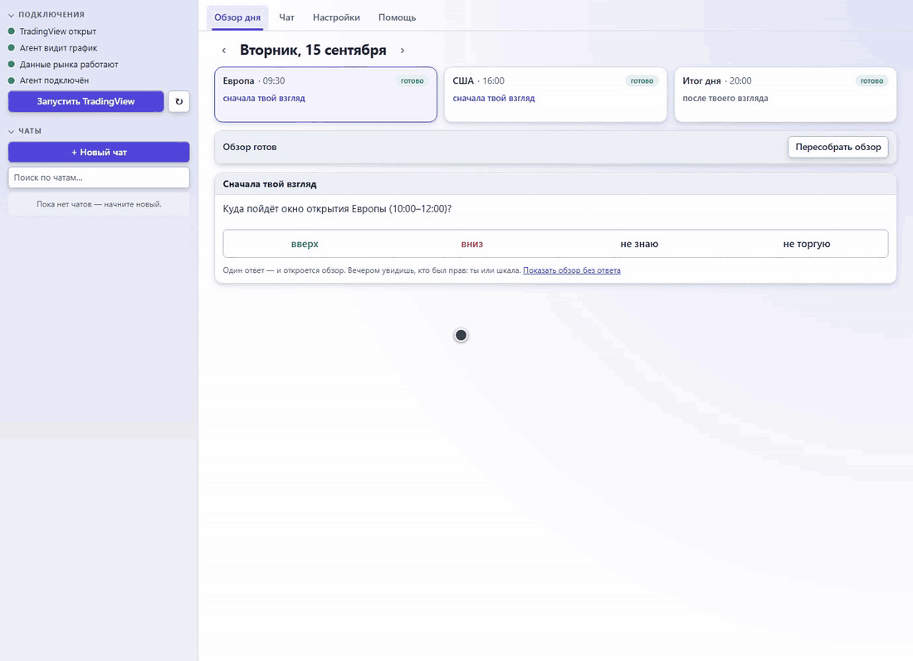

## 6. Утро: обзор перед Европой

### 6.1. Что происходит в 09:30

Планировщик запускает обзор сам. На экране откроется окно терминала с агентом: он собирает новости, смотрит график, пишет файлы. Это окно трогать не нужно, оно закроется само или останется с готовым обзором. В программе плитка «Европа» покажет «собирается», потом «готово». Обычно это пять-десять минут.

Если программа в 09:30 не была открыта, ничего страшного: обзор всё равно сделан, откройте программу позже и он уже на месте.

Если обзора нет (компьютер спал, расписание выключено), на плитке будет «пора» или «обзора не было». Нажмите на неё и затем **«Запустить обзор»**: агент сделает обзор прямо сейчас, несколько минут.

### 6.2. Сначала ваш взгляд

Нажмите на плитку «Европа». Вместо стрелки вы увидите вопрос: «Куда пойдёт окно открытия Европы (10:00–12:00)?» и четыре кнопки: **вверх**, **вниз**, **не знаю**, **не торгую**.

Нажмите одну. Это не экзамен, никто не ставит оценку в момент ответа. Это нужно, чтобы вечером сравнить ваш взгляд со шкалой и увидеть, кто чаще прав. Если ответить не хотите, есть ссылка «Показать обзор без ответа»: обзор откроется, а в журнале честно запишется, что взгляд дан после стрелки.

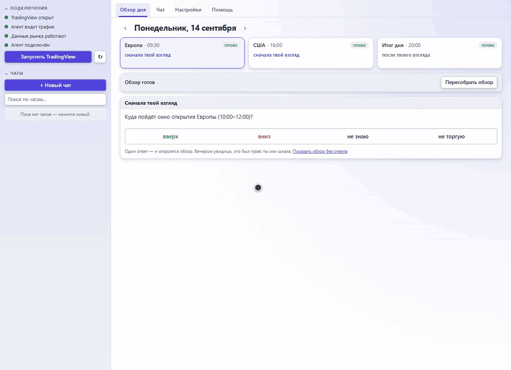

### 6.3. Что открылось

Сверху полоска: «Твой взгляд: вниз. Шкала: вверх. Расходитесь — вечером узнаем, кто прав» (или «вы сходитесь»).

**Сегодня помни.** До трёх строк, которые агент выбрал под сегодняшний день: урок из журнала с такими же условиями, правило, которое сегодня включено, похожий день из прошлого и чем он кончился. Если карточки нет, значит, напомнить нечего.

**Что изменилось.** Появляется только когда есть что сказать: сменилась фаза рынка, сжался дневной ход, фактор, который угадывал неделями, стал ошибаться.

**Куда смотрит рынок.** Стрелка на полукруге. Влево — перевес в шорт, вправо — в лонг, посередине — перевеса нет. Число под стрелкой — размер перевеса в процентах (`+54 %` значит сильный лонг). Ниже полоса «за лонг · неясно · за шорт» и строка светофора:

- зелёная «Можно торговать, риск 1 %»;
- жёлтая «Торгуем осторожно, риск 0,5 %»;
- красная «Сегодня не торгуем» (красная новость в окне, праздник, нет направления).

Нет перевеса или красный светофор, значит, по правилам день пропускаем. Программа так и напишет.

**Что делать.** Мнение агента своими словами: куда вероятнее пойдёт цена, где ждать ложный вынос, где вход, стоп и цель по вашим правилам, до какого времени, что отменяет идею. Под ним строка «новости за лонг / за шорт / нейтральные» и одна фраза почему.

**Почему так.** Два столбика: факторы за лонг и за шорт с их весом в процентах. Нажмите на любой фактор, откроется окно: что это за фактор, когда он голосует за лонг, когда за шорт, как часто угадывал за последние 30 дней.

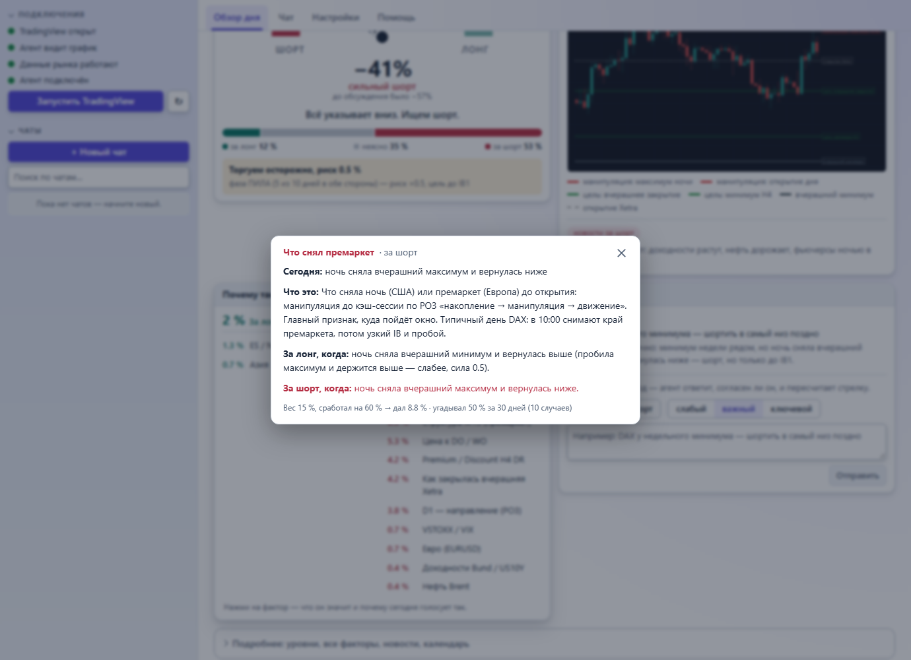

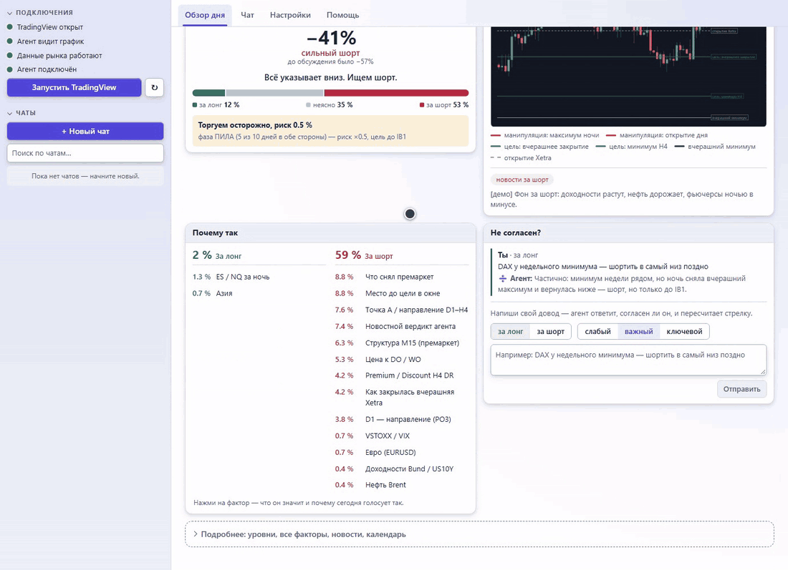

Ниже, если TradingView была открыта: **Уровни на графике**, картинки с нарисованными уровнями (можно открыть крупно), **Причины**, **Риски** (со временем, например «15:30 инфляция США»), **Что проверить на открытии**, **Новости по времени**, **Рынки к вчерашнему закрытию**.

### 6.4. Если вы не согласны

Блок **«Не согласен?»** внизу обзора:

1. Выберите, за что ваш довод: **за лонг** или **за шорт**.
2. Выберите, насколько он важен: **слабый** (5 %), **важный** (10 %), **ключевой** (20 %).
3. Напишите довод своими словами, например «DAX у недельного минимума, шортить поздно».
4. Нажмите отправить. Если довод — это картинка (скриншот графика), отправьте её в чате обзора: «Открыть разговор» на плитке, там есть кнопка «Прикрепить».

Агент ответит, согласен ли он (согласен / частично / не согласен) и почему, запишет ваш довод в шкалу и пересчитает стрелку. Утренняя стрелка останется пунктиром, видно, что изменилось. Если стрелка ушла в «нет перевеса», по правилам это пропуск, агент об этом скажет. Ваш довод попадает в «Идеи на проверке» (раздел 9), вечером агент проверит, подтвердился ли он.

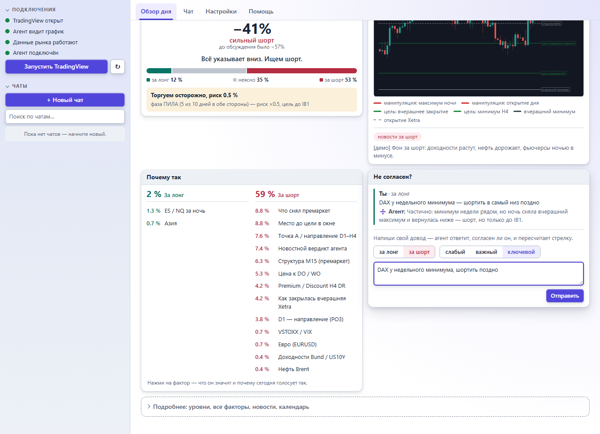

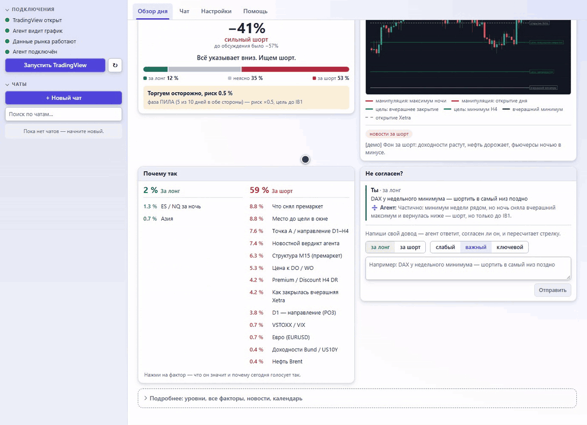

Кнопка **«Открыть разговор»** на плитке открывает чат этого обзора целиком: там видно, что агент делал, и можно задать вопрос по обзору.

Кнопка **«Пересобрать обзор»** делает обзор заново (несколько минут и токены). Прошлое обсуждение при этом сохраняется.

## 7. День: обзор перед Америкой

В 16:00 всё то же самое для плитки **США**: ваш взгляд на окно 16:30–18:30, стрелка, план, доводы. Инструменты: S&P 500 (ES) и Nasdaq (NQ). В неделю, когда Америка уже перевела часы, а Европа ещё нет (и наоборот), обзор приходит в 15:00, а открытие в 15:30.

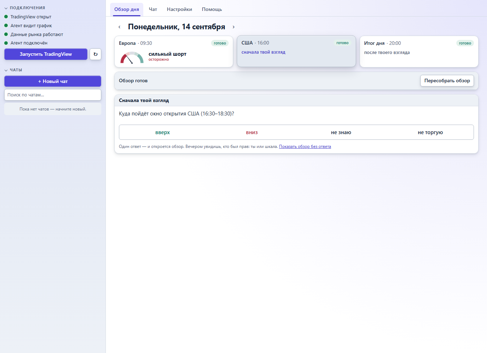

## 8. Вечер: итог дня

### 8.1. Два ответа от вас

В 20:00 плитка **Итог дня** сначала задаёт два вопроса, это единственное, что нужно от вас вечером:

1. **Брал ли сделку?** По каждому региону: «не брал», «лонг», «шорт». Если брал, то «по правилу», «не по правилу» или «не уверен».
2. **Что помогло или помешало? Одна строка.** Например: «ждал вторую манипуляцию, как в уроке 08.10, сработало».

Нажмите **«Сохранить»**. Потом ответы можно изменить.

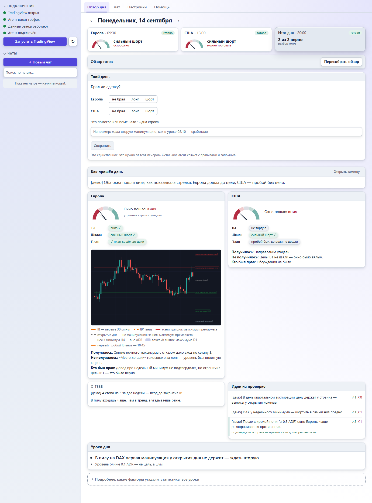

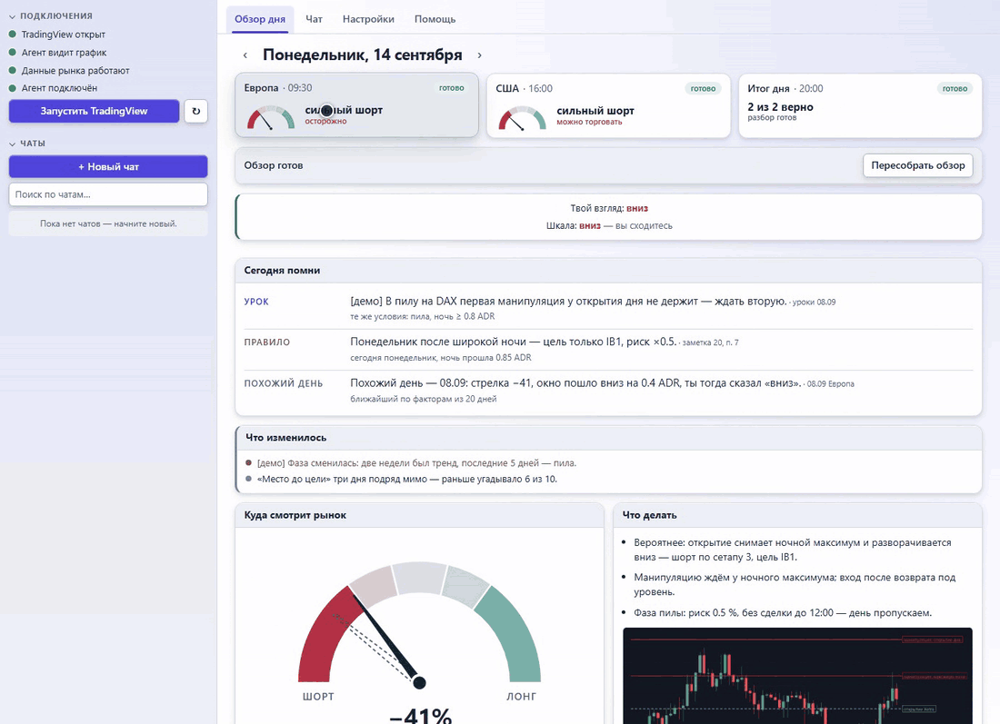

### 8.2. Что показывает итог

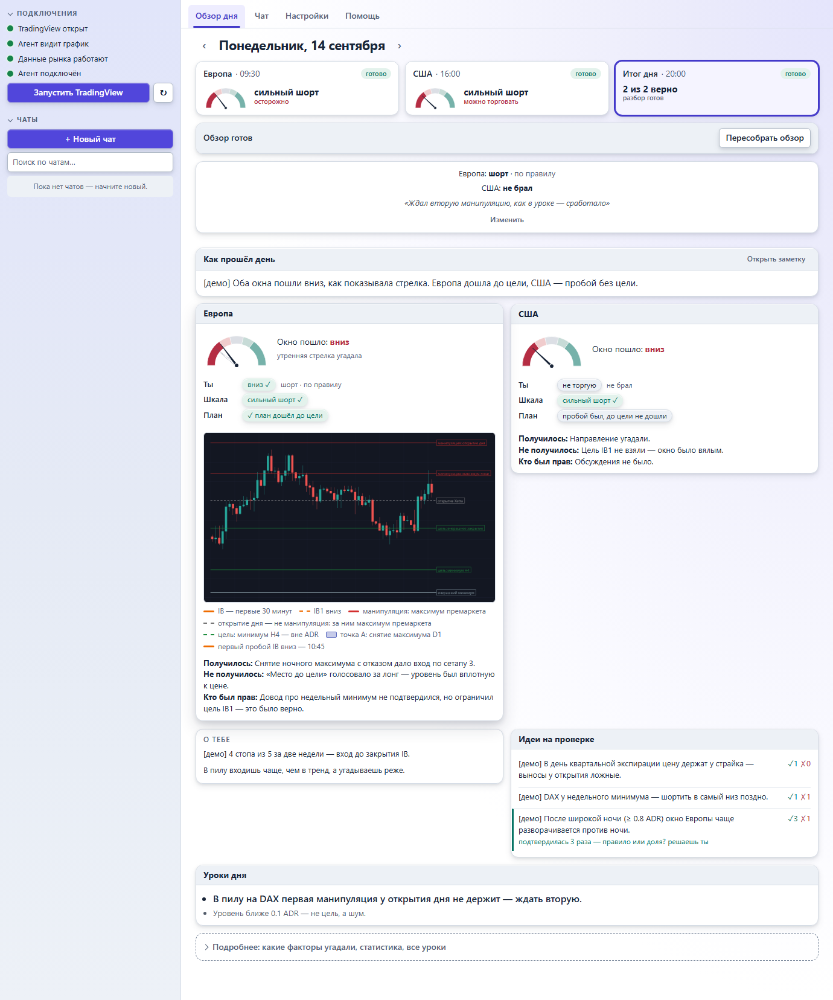

По каждому региону:

- **Утром** была стрелка такая-то, **окно пошло** вверх или вниз и на сколько, «стрелка угадала» или «ошиблась».
- **Кто был прав**: ты, шкала, план. Из фактов, без оценок.
- **Получилось / Не получилось**: что из плана сработало, где агент ошибся и почему, кто был прав в обсуждении.
- **Уроки дня**: один главный урок на экране. Остальные агент записывает в журнал и перечитывает перед следующими обзорами.
- **Какие факторы угадывают (30 дней)**: какие факторы шкалы чаще правы, какие нет. Веса меняются только раз в месяц и только с вашего «да».
- **Уровни на графике**: картинка окна открытия, видно, какие уровни взяли.

Если урок повторился три раза, агент предложит сделать его правилом. Решаете вы, в чате.

## 9. Пятница: неделя и идеи

В пятницу вечером к итогу дня добавляется **«Неделя в пять строк»**: каким был рынок, что сработало, какой урок повторился, одна идея на проверку, одно предложение по весу фактора. Ниже **«О тебе»**: что агент заметил в вашей торговле за эти недели (сделки не по правилу, против стрелки, в красный день). Без упрёка, из ваших же ответов.

**«Идеи на проверке»**: всё, что вы говорили агенту «а мне кажется…», со счётом «подтвердилась / опровергнута». Три подтверждения, и агент предлагает правило или вес. Кнопок здесь нет нарочно: решение принимается в чате, словами.

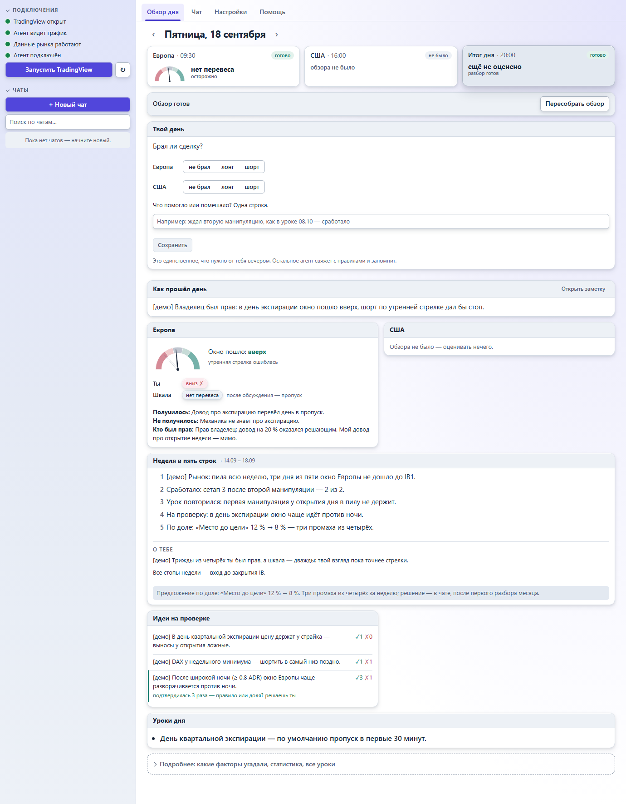

## 10. Вкладка «Чат»

Это вопросы агенту, который помнит всё: обзоры, уроки, ваши ответы, заметки. Например:

- «Что из уроков подходит к сегодняшнему дню?»
- «Какое правило я нарушаю чаще всего?»
- «Был ли похожий день в этом месяце и чем он кончился?»
- «Что значит фактор «что снял премаркет»?»

Нажмите «+ Новый чат» слева или вкладку «Чат», напишите вопрос, Enter. Можно прикрепить файл или скриншот: кнопка «Прикрепить», перетащить в окно или Ctrl+V после снимка экрана. Агент отвечает коротко, из ваших данных, с датой или уроком, который он цитирует. Сделки он не открывает и обзор из этого чата не меняет: для этого есть чат обзора («Открыть разговор» на плитке).

## 11. Настройки

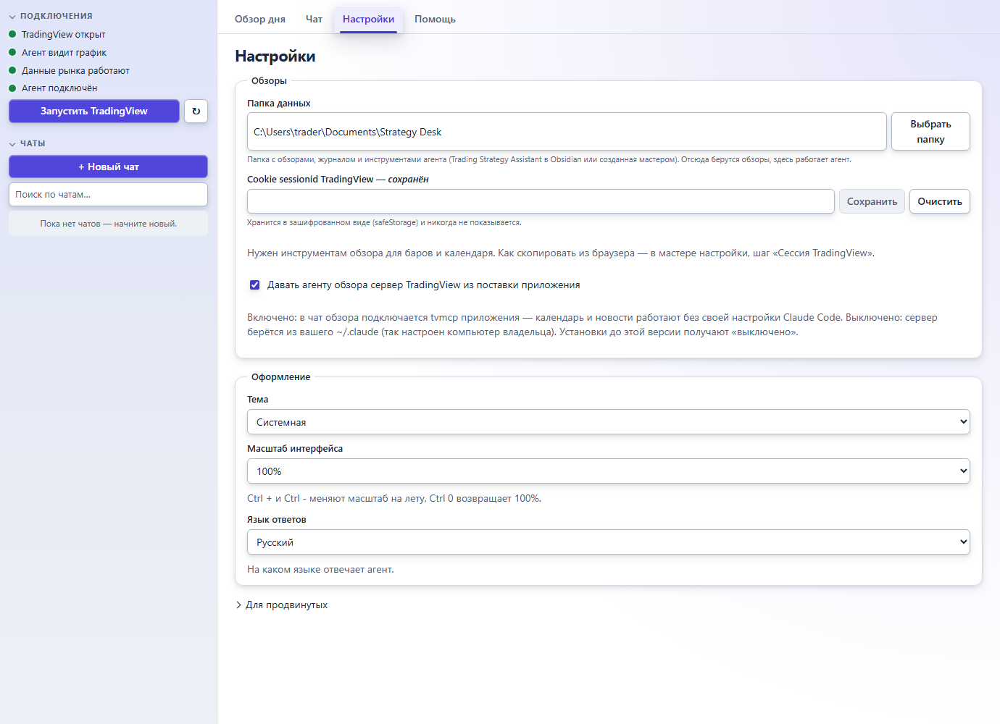

Что может понадобиться:

- **Папка данных**: где лежат обзоры. Менять только если переносите папку.
- **Cookie sessionid TradingView**: сюда вставляют новый cookie, если старый перестал работать (вышли из аккаунта в браузере).
- **Давать агенту обзора сервер TradingView из поставки**: оставьте включённым.
- **Тема**: системная, тёмная, светлая. **Масштаб интерфейса**: Ctrl + и Ctrl − на лету, Ctrl 0 возвращает 100 %.
- **Для продвинутых**: подключения, модель, диагностика, старые инструменты. Для обзоров дня там обычно ничего менять не нужно. **Диагностика** внутри показывает те же проверки, что мастер, все разом, с кнопкой «Проверить заново».
- Кнопка **«Мастер настройки»** во вкладке «Помощь» открывает мастер заново.

## 12. Если что-то не работает

| Что видно | Что сделать |
|---|---|
| Лампочка «Агент не подключён — войди в Claude» | Помощь → Мастер настройки → шаг «Claude» → «Войти в Claude» |
| «Агент не видит график» | Закройте TradingView полностью (трей → Выход) и нажмите «Запустить TradingView» в программе |
| «Данные рынка не работают» | Настройки → Для продвинутых → Диагностика → «Проверить заново». Если строка «Рынок» красная, нажмите «Развернуть рантайм» |
| В обзоре нет баров, календаря или написано про cookie | Cookie устарел: скопируйте новый (раздел 4.5) в Настройках → «Cookie sessionid TradingView» и «Проверить» |
| Обзор в 09:30 не пришёл | Компьютер спал или был выключен; расписание не включено (мастер, шаг «Расписание»); часовой пояс не киевский. Обзор можно запустить вручную: плитка → «Запустить обзор» |
| Задача планировщика падает с «0x80070002 Не удается найти указанный файл» или заголовок окна вроде «РњР°РєСЂРѕ US» | Расписание включала версия 0.2.1. Обновитесь до 0.2.2 и один раз нажмите «Включить расписание» заново (Настройки → Диагностика → «Задачи планировщика», или мастер → шаг «Расписание») |
| Обзор пришёл в другое время | Часовой пояс компьютера не киевский. Параметры Windows → Время и язык → Дата и время |
| Плитка «собирается» дольше 20 минут | Нажмите «Открыть разговор» и посмотрите, что пишет агент; если он остановился, «Пересобрать обзор» |
| Плитка показывает «Этот обзор не получилось показать» | Нажмите «Попробовать снова». Если повторяется, напишите разработчику, приложив файлы из `Документы\Strategy Desk\indices-kb\state` за этот день |
| Windows SmartScreen при запуске установщика | «Подробнее» → «Выполнить в любом случае». Подписи издателя у программы пока нет |
| Нужно всё проверить разом | Настройки → Для продвинутых → Диагностика. Каждая красная строка говорит, что делать, и даёт кнопку, где программа может сделать сама |
| «Не удалось проверить обновления» | Нет интернета или GitHub не отвечает. Повторите позже; новую версию всегда можно поставить руками со страницы релизов |
| «Сначала дождитесь, пока агент закончит» при установке обновления | Идёт обзор или задача. Подождите, пока плитка станет «готово», и нажмите «Установить и перезапустить» ещё раз |

### Как обновить программу

Программа сама спрашивает GitHub, не вышла ли новая версия: через полминуты после запуска и дальше раз в несколько часов. Когда версия есть, под вкладками появляется полоска «Вышла версия …». Ничего не скачивается без вашего нажатия.

1. Нажмите **«Скачать»** в полоске или откройте Настройки → **«Справка»** → «Проверить обновления» → «Скачать». Установщик (около 190 МБ) скачивается в фоне, видна полоса прогресса.
2. Когда скачалось, нажмите **«Установить и перезапустить»**. Программа закроется, тихо поставит новую версию поверх старой и откроется снова. Настройки, чаты и папка данных остаются.
3. Если в этот момент идёт обзор или задача, программа откажется и попросит подождать: установщик не должен менять файлы, которыми пользуется агент.

В «Справке» же: версия программы, список изменений по версиям (changelog), кнопки «Сообщить об ошибке» и «Веб-сайт» и галочка «Проверять обновления автоматически».

Версии 0.2.0 и старше обновляться сами не умеют: их надо один раз обновить руками, установщиком с той же страницы релизов (ставится поверх, ничего не теряется). С 0.2.1 всё дальше приходит само.

## 13. Где лежат данные и как удалить

- **Папка данных** (обзоры, журнал, уроки, инструменты агента): та, что вы выбрали в мастере, по умолчанию `Документы\Strategy Desk`. Это обычные файлы, их можно открывать в Obsidian или любым редактором. Обзоры в `Макро-обзоры\`, уроки в `indices-kb\journal\lessons.md`.
- **Настройки, чаты и окружение Python**: `%APPDATA%\strategy-desk` (вставьте этот путь в адресную строку проводника). Секреты (cookie) там зашифрованы.
- **Удалить программу**: Параметры Windows → Приложения → Strategy Desk → Удалить. Деинсталлятор спросит, удалять ли окружение Python (600 МБ). Папку данных, чаты и настройки он не трогает никогда. Если хотите стереть всё, удалите папку данных и `%APPDATA%\strategy-desk` руками.

## 14. Словарь

| Слово | Что значит |
|---|---|
| **Окно открытия** | Первые два часа после открытия торгов: Европа 10:00–12:00, Америка 16:30–18:30 по Киеву. Именно за это окно отвечает стрелка |
| **Стрелка, перевес** | Разница между весом факторов за лонг и за шорт. +54 % значит сильный перевес в лонг, −10 % значит перевеса нет |
| **Шкала** | Набор факторов (структура графика, что сняла ночь, новости, доходности, нефть…), у каждого свой вес. Их сумма и даёт стрелку |
| **Фактор** | Один признак в шкале. Например «что снял премаркет» или «направление D1» |
| **Светофор** | Можно ли сегодня торговать по правилам: зелёный да, жёлтый осторожно с половинным риском, красный нет |
| **Лонг / шорт** | Покупка в расчёте на рост / продажа в расчёте на падение |
| **IB** | Initial Balance, диапазон первых 30 минут торгов (Европа) или часа (Америка). IB1 — такой же диапазон, отложенный вверх или вниз от его края |
| **ADR** | Средний дневной ход цены за последние дни. «0,3 ADR» значит треть обычного дневного хода |
| **Ложный вынос (манипуляция, снятие уровня)** | Цена заходит за важный уровень, собирает стопы и разворачивается в другую сторону |
| **Премаркет** | Торги фьючерсом ночью и утром до открытия основной сессии (для DAX с 02:15 до 10:00) |
| **Дневная сессия (Xetra, NYSE)** | Основные торги самим индексом: DAX на Xetra 10:00–18:30, S&P 500 на NYSE 16:30–23:00 по Киеву |
| **DO / WO** | Цена открытия дня / недели |
| **PDH / PDL** | Максимум / минимум вчерашнего дня |
| **Точка A** | Место, где рынок снял важный уровень и развернулся: с него начинается направление дня |
| **FVG, OB** | Зоны на графике из курса Smart Money, где ждут реакцию цены. Для обзора знать не обязательно |
| **Cookie sessionid** | Строка в браузере, по которой tradingview.com узнаёт, что вы вошли. Нужна программе для баров и календаря |
| **Планировщик Windows** | Встроенная в Windows служба, которая запускает программы по расписанию. Он и запускает обзоры |
| **Обновление, релиз** | Новая версия программы на странице релизов GitHub. Программа находит её сама и ставит по нажатию: Настройки → Справка |
| **Claude, Claude Code, агент** | Claude — нейросеть Anthropic; Claude Code — программа, через которую она работает с файлами; агент — так мы зовём её в обзорах |
| **tvmcp, сервер рыночных данных** | Часть программы, которая берёт бары, календарь и новости и считает уровни |

Полный словарь терминов обзоров лежит в папке данных: `.claude\skills\humanizer\glossary.md`. Если встретили непонятное слово в обзоре, спросите в чате: «что значит …», агент объяснит и добавит слово в словарь.
